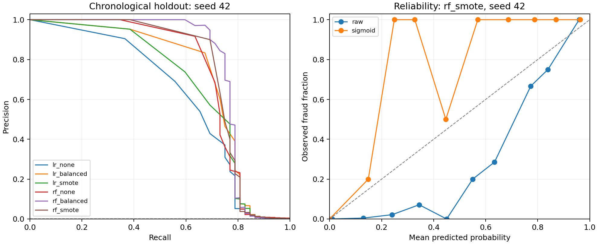

# Rare-event classifiers under distribution shift

## Findings

The validation-selected configuration was **rf_smote / sigmoid**.
For the predeclared representative seed 42, the
chronological test average precision was **0.7547**,
precision **0.9474**, and recall **0.6923** at the
validation-selected threshold 0.207680.

At a controlled fraud prevalence of 0.05%, with identical class-conditional
observations and fixed decisions, precision was **0.8804** while
recall remained **0.6923**. This isolates sensitivity to the class prior.
It is not evidence of a change observed at a bank or a robust deployment.

## Design

The public ULB/Worldline dataset contained 284,807 rows and
492 frauds. Exact deduplication removed
1,081 rows before a chronological 55/15/15/15
split, keeping timestamp ties together. No full-dataset fitted scaling or
full-hour transaction-count feature was used. V1-V28 plus log1p(Amount) were
scaled on the training partition only. The upstream PCA provenance is unknown.

| Partition | Rows | Frauds | Prevalence | Time range (seconds) |
| --- | --- | --- | --- | --- |
| train | 156049 | 332 | 0.2128% | 0-108576 |
| calibration | 42558 | 34 | 0.0799% | 108580-132905 |
| validation | 42558 | 55 | 0.1292% | 132906-151319 |
| test | 42561 | 52 | 0.1222% | 151320-172792 |

Six fixed model/imbalance variants were trained with seeds 42,43,44. Calibration
used a separate partition at natural prevalence. Variant selection maximized
mean raw validation AP; probability mapping minimized validation log loss for
that variant. Thresholds maximized validation F1. All decisions were frozen
before test prediction. F1 does not encode real fraud-loss or investigation costs.
See [the complete protocol](PROTOCOL.md) and [implementation](experiment.py).

## All predeclared comparisons

Natural chronological holdout; mean (population standard deviation) over three
training seeds on the SAME split. These deviations are not confidence intervals.
AP means sklearn average precision, not trapezoidal area under the PR curve.

| Variant | Probabilities | AP | Precision | Recall | Brier | Log loss |
| --- | --- | --- | --- | --- | --- | --- |
| lr_balanced | raw | 0.6864 (0.0000) | 0.8974 (0.0000) | 0.6731 (0.0000) | 0.0348 (0.0000) | 0.1365 (0.0000) |
| lr_balanced | sigmoid | 0.7248 (0.0000) | 0.8974 (0.0000) | 0.6731 (0.0000) | 0.0005 (0.0000) | 0.0031 (0.0000) |
| lr_none | raw | 0.6179 (0.0000) | 0.5893 (0.0000) | 0.6346 (0.0000) | 0.0008 (0.0000) | 0.0043 (0.0000) |
| lr_none | sigmoid | 0.6179 (0.0000) | 0.5893 (0.0000) | 0.6346 (0.0000) | 0.0007 (0.0000) | 0.0039 (0.0000) |
| lr_smote | raw | 0.6909 (0.0035) | 0.7063 (0.0029) | 0.6474 (0.0091) | 0.0029 (0.0000) | 0.0193 (0.0003) |
| lr_smote | sigmoid | 0.6850 (0.0116) | 0.7063 (0.0029) | 0.6474 (0.0091) | 0.0006 (0.0000) | 0.0034 (0.0000) |
| rf_balanced | raw | 0.7641 (0.0024) | 0.8803 (0.0494) | 0.7244 (0.0240) | 0.0006 (0.0000) | 0.0090 (0.0011) |
| rf_balanced | sigmoid | 0.7641 (0.0024) | 0.8803 (0.0494) | 0.7244 (0.0240) | 0.0005 (0.0000) | 0.0037 (0.0005) |
| rf_none | raw | 0.7384 (0.0029) | 0.7757 (0.0443) | 0.6987 (0.0091) | 0.0005 (0.0000) | 0.0032 (0.0000) |
| rf_none | sigmoid | 0.7384 (0.0029) | 0.7757 (0.0443) | 0.6987 (0.0091) | 0.0005 (0.0000) | 0.0032 (0.0000) |
| rf_smote | raw | 0.7563 (0.0025) | 0.8702 (0.0551) | 0.7051 (0.0091) | 0.0011 (0.0000) | 0.0141 (0.0005) |
| rf_smote | sigmoid | 0.7563 (0.0025) | 0.8702 (0.0551) | 0.7051 (0.0091) | 0.0004 (0.0000) | 0.0029 (0.0001) |

Do not interpret the best test-table cell as the selected model. Selection used
validation data only. Calibration is assessed through Brier/log loss and the
reliability diagram, while recognizing that the proper scores also reflect
discrimination. ECE and full confusion values are in the aggregate JSON.
The sigmoid mapping uses clipped log-odds. Clipping and floating-point
saturation can merge score ties, so AP can change even though the mapping is
monotone. In particular, the calibrated Logistic Regression AP change is not
evidence that calibration learned better feature discrimination.

For the selected variant, mean test log loss was 0.0141
raw and 0.0029 after calibration. The highest mean
raw test AP belonged to rf_balanced; this is a descriptive comparison and does
not justify changing the frozen selection or claiming universal superiority.

## Prior-shift sensitivity

Selected configuration, representative seed. Exact class reweighting preserves
empirical P(X|Y), with no model, calibration or threshold adaptation. These are
four views of the same test observations, not four independent datasets.

| Scenario | Fraud rate | AP | ROC-AUC | Precision | Recall | Brier | Log loss |
| --- | --- | --- | --- | --- | --- | --- | --- |
| chronological | 0.1222% | 0.7547 | 0.9599 | 0.9474 | 0.6923 | 0.000429 | 0.002960 |
| prior_0.0005 | 0.0500% | 0.7305 | 0.9599 | 0.8804 | 0.6923 | 0.000185 | 0.001377 |
| prior_0.005 | 0.5000% | 0.7926 | 0.9599 | 0.9867 | 0.6923 | 0.001710 | 0.011245 |
| prior_0.01 | 1.0000% | 0.8113 | 0.9599 | 0.9933 | 0.6923 | 0.003405 | 0.022209 |

## Conditional uncertainty

| Metric | Point estimate | 95% bootstrap interval |
| --- | --- | --- |
| average_precision | 0.754727 | [0.625800, 0.866705] |
| precision | 0.947368 | [0.866622, 1.000000] |
| recall | 0.692308 | [0.576923, 0.807692] |
| brier | 0.000429 | [0.000289, 0.000564] |

The 200 class-stratified bootstrap intervals hold the fitted model, chosen
threshold and class counts fixed. They exclude model-selection uncertainty,
training-data uncertainty, changing prevalence and dependence between
transactions. They should not be read as evidence of significant differences
between candidates. The representative seed was fixed before evaluation.

## Figures



Left: subsampled PR curves for all six variants at seed42; dashed line is
test prevalence. Right: selected variant, raw and sigmoid reliability, with
10 equal-width probability bins. Counts per bin are in reliability.json;
sparsely occupied high-probability bins are especially uncertain.

## Limitations and next experiments

- Only two days of anonymized transactions and relatively few positive cases.
  No card IDs, raw feature meanings, external validation or deployment cost data.
- A chronological holdout measures later-period performance but does not by
  itself establish or identify distribution shift. Prior reweighting covers
  only label shift, not changing P(X|Y), label errors, or adversarial behavior.
- Small calibration/validation fraud counts can produce unstable mappings and
  thresholds. Low aggregate Brier or ECE alone is insufficient for rare events.
- The legacy Flask path has separate preprocessing and serving issues and is
  not validated by this study. No trained research model is deployed here.
- Future work should use additional temporal windows and an independent dataset,
  a business-cost threshold, and calibration uncertainty. Such changes need a
  fresh evaluation protocol and holdout; do not tune to the test results above.

## Reproduction

```bash
pip install -r research/requirements-lock.txt
python -m pytest tests/ -q
python -m research.experiment --data data/creditcard.csv --output research/results/new-run
python -m research.report --run research/results/new-run
```

Python 3.12.14; dependency versions, seeds, source/protocol hashes,
Git state, timestamp ranges and row-ID hashes are in manifest.json. Input SHA256:
`76274b691b16a6c49d3f159c883398e03ccd6d1ee12d9d8ee38f4b4b98551a89`.
The dataset and any personal academic/application records are excluded from Git.

Dataset attribution: ULB Machine Learning Group and Worldline;
[original Kaggle dataset](https://www.kaggle.com/datasets/mlg-ulb/creditcardfraud).
Download mirror verified in the
[TensorFlow tutorial](https://www.tensorflow.org/tutorials/structured_data/imbalanced_data).
